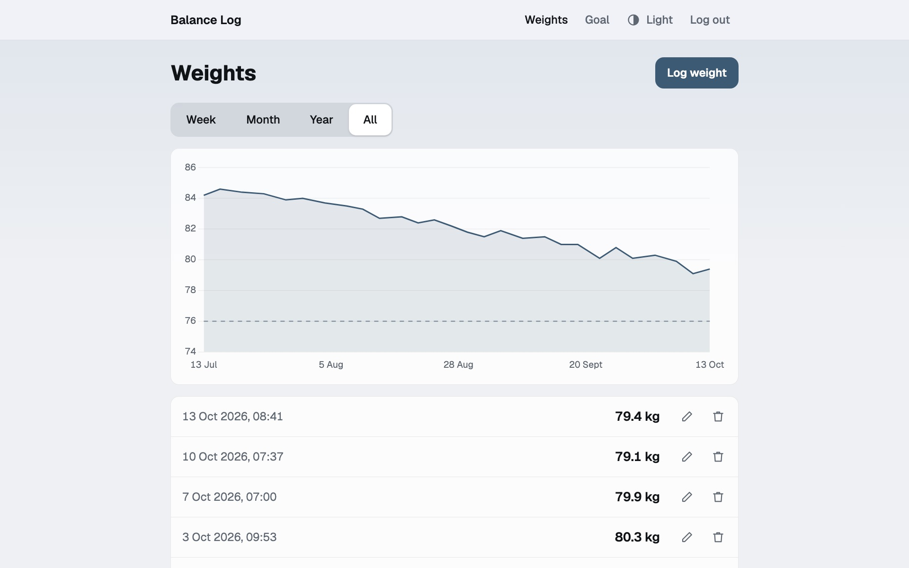
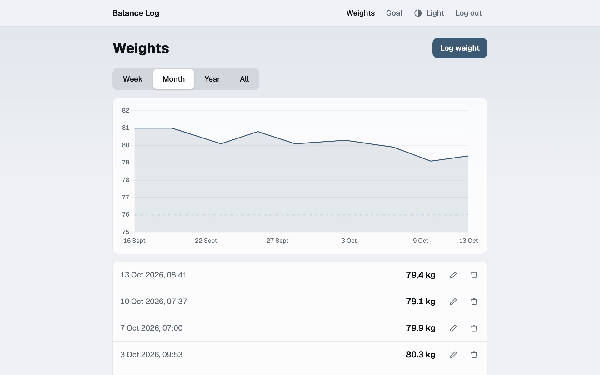
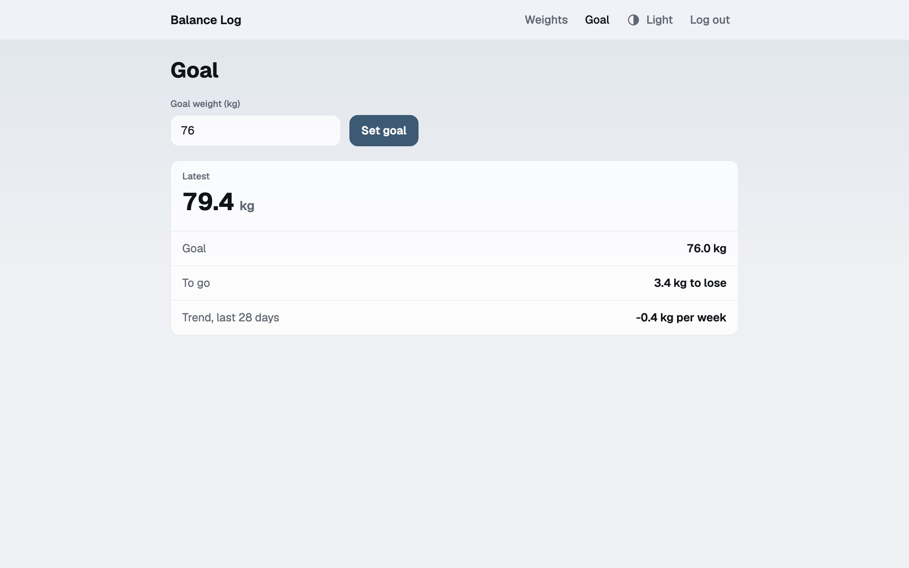
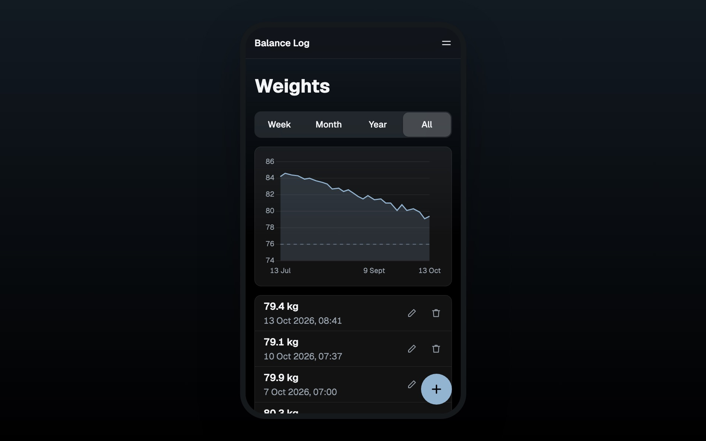
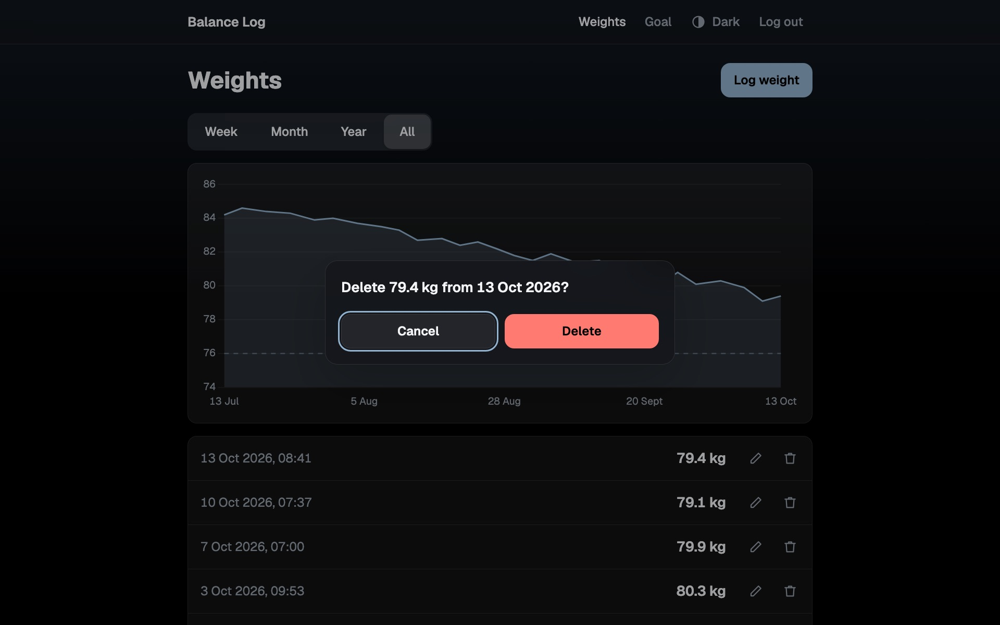

# Balance Log — frontend

**A weight tracker.** Log your weight whenever you step on the scale, see the history and the curve, set a goal weight and follow your progress.

**Open it: https://balance-log-frontend.onrender.com**

<table>
  <tr>
    <td></td>
    <td></td>
  </tr>
  <tr>
    <td></td>
    <td></td>
  </tr>
</table>

The pictures show invented data.

This repo is the Vue frontend. The Spring Boot REST API is in [balance-log-backend](https://github.com/Reconnact/balance-log-backend).

## How to use

The app runs on Render's free plan. After a quiet spell the server sleeps, and the first request wakes it in up to 90 seconds; the app says so while you wait.

1. **Register** with your email and a password of 8 to 72 characters, then log in.
2. **Log a weight** with *Log weight*, or the round + on a phone. Enter the weight in kg, between 20 and 400, with one decimal. The time starts at now; change it for an older weighing.
3. **See the history** on the *Weights* page: the curve on top, the entries below, newest first.
4. **Filter by period** with *Week*, *Month*, *Year* or *All* above the curve.
5. **Edit or delete** an entry with the pencil or the bin in its row. A delete asks first.
6. **Set a goal** on the *Goal* page. The curve then shows it as a dashed line.
7. **Follow your progress** on the *Goal* page: your latest weight, the kg to go and your trend per week over the last 28 days. The trend needs at least two weights that lie 7 days apart.

The theme button in the header switches between the system setting, light and dark. *Log out* ends the session; after 7 days the app asks you to log in again.

Each account sees only its own weights.

## Run

Needs Node 26 and the backend on http://localhost:8080 (`./gradlew bootRun` in balance-log-backend).

    npm install
    npm run dev

Then open http://localhost:5173.

## Test

    npm run test:unit

GitHub Actions runs the tests on every push.

Webtechnologien project, HTW Berlin, WiSe 2026/27.
